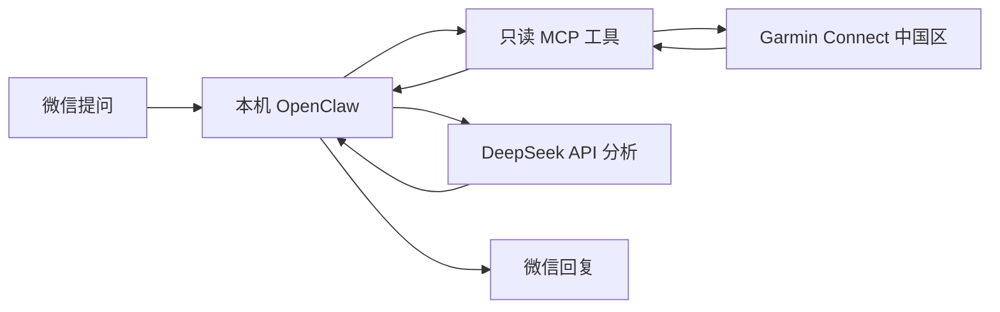

# Garmin 微信私人教练

通过微信查询自己的 Garmin 数据，用 DeepSeek 分析睡眠、恢复和训练。基于 OpenClaw、Garmin Connect 中国区与只读 MCP 工具。

你可以问：“昨晚深睡多久？”“最近跑步的心率和功率有什么变化？”也可以直接告诉 bot：“以后日报只保留睡眠、恢复和今天的训练建议，控制在 300 字以内。”

## 已支持什么

- **10 个数据查询工具和 1 个绘图工具**：健康摘要、睡眠详情、健康曲线、训练指标、运动列表与详情、训练课、个人纪录和设备能力。
- **按问题取数**：默认使用摘要，曲线和运动详情按需读取，不会因为接入更多字段就每次查询或展示全部数据。
- **曲线图片**：可把日间健康、睡眠阶段、运动表现和多日趋势画成 PNG，通过微信回复附图。
- **微信调整内容偏好**：主题、篇幅、语气和展示重点可在聊天中调整，保存到私有工作区，供下次聊天和日报使用。
- **明确数据边界**：保留缺失、历史日期、过期标记、抽样信息与读取失败状态；不生成 255 不支持的分数。
- **只读佳明**：不会改动活动、手表设置或下发训练。GPS 轨迹须在详情查询中显式开启。

本机已使用 Forerunner 255 中国区账号验证 MCP 查询和微信收发。其他型号、地区或固件需自行验证，接口有字段不代表账号一定有数据。

## 数据如何流动



手表先通过 Garmin Connect 同步。程序查询云端已有记录，不直接实时连接手表。被选中的数据和必要的聊天上下文会交给模型服务分析；微信、佳明和模型供应商都会参与相应的数据流。

## 开始使用

需要 Windows、Python 3.12、佳明中国区账号、DeepSeek API 密钥，以及可绑定的微信渠道。OpenClaw 固定为 `2026.10.6`；本项目启动脚本接受 Node `>=24.22.1 <25` 或 `>=26.12.1`。

```powershell
git clone https://github.com/Flourshing/garmin-coach.git
cd garmin-coach
python -m venv .venv
.\.venv\Scripts\python.exe -m pip install -r requirements.txt
```

接下来按 [安装与启动](docs/SETUP.md) 准备运行时、填写本机密钥、登录佳明并绑定微信。准备完成后，日常双击 **`启动佳明教练.cmd`**。

本机模式需要电脑保持开机、联网和唤醒。每天 08:00 的任务由准备脚本创建为**停用**状态；配置了任务不等于已启用推送。电脑关机后继续运行，需要另行部署常驻服务，见 [云端部署](deploy/README.md)。

## 可以读取的数据

| 工具 | 用途 |
| --- | --- |
| `get_health_summary` | 连续 1–28 天的睡眠分期、HRV、心率、压力、电量、步数、热量和运动摘要 |
| `get_recent_activities` | 分页运动列表、活动编号、名称与已有表现指标 |
| `get_sleep_details` | 一晚睡眠详情，可按需附带阶段、心率、血氧、呼吸等曲线 |
| `get_health_timeseries` | 按类别读取指定一天的健康曲线与事件 |
| `get_training_metrics` | 训练状态、负荷、VO₂max、比赛预测、健康年龄、阈值、FTP 和区间设置 |
| `get_activity_details` | 单次运动的摘要、曲线、分圈、区间、力量组数等 |
| `get_training_workouts` | 自定义训练课、步骤、月份日历和已有计划 |
| `get_personal_records` | 已有个人纪录及关联运动 |
| `get_device_capabilities` | 型号和功能支持标记 |
| `get_data_status` | 检查本地凭证文件是否存在，不验证在线登录 |
| `render_garmin_chart` | 按需绘制日间、睡眠、运动或多日趋势图片，保存本地，由微信回复管线附图 |

参数、查询示例与单位说明见 [MCP 数据接口](docs/MCP.md)，绘图用法见 [曲线图片](docs/CHARTS.md)。数据查询的曲线默认最多 240 点，可选 2–2000 点；绘图默认 1000 点，可选 100–2000 点。长曲线会抽样并标记；当天或最新类缓存 15 分钟，历史日期缓存 24 小时。

## 在微信里调整推送

可以直接说：

> 以后日报不展示血氧和热量，重点分析睡眠分期、HRV 和训练负荷。先给结论，再给两三项依据，控制在 300 字以内。请保存为长期偏好。

bot 应将长期要求写入 `PREFERENCES.md`，读回核对后再确认保存。只针对本次的要求不会自动覆盖长期设置。

| 调整内容 | 在微信中处理 |
| --- | --- |
| 主题、字数、语气、已有指标的展示、分析回看范围 | 可以，保存偏好后用于后续回复和日报 |
| 选择已有工具或分类查询 | 可以，在工具参数范围内按问题选择 |
| 新增底层字段、严格禁止某数据传给模型、改变单位或计算方式 | 需要改 MCP 代码；隐藏展示不等于停止读取 |
| 推送时间、启停、收件人 | 需要修改并验证定时任务，当前 bot 不具备任务管理权限 |

普通内容偏好无需回到 GPT 确认。详细说明见 [微信偏好与持久化](docs/PREFERENCES.md)。

## 文件怎么组织

```text
coach/                    初始规则、用户资料、偏好和记忆模板
  PREFERENCES.md           内容偏好模板
  SOUL.md / AGENTS.md      项目维护的规则
  USER.md / MEMORY.md      初始用户资料与长期记忆
docs/                     安装、接口、偏好和开发说明
tests/                    离线测试，不连接账号或模型
scripts/diagnostics/      可选的微信、模型连接检查
deploy/                   容器启动、供应商配置和部署文档
garmin_mcp_server.py       MCP 工具入口
garmin_service.py         摘要查询和缓存
garmin_extended.py        分类查询、曲线和运动详情
garmin_data.py            共享字段、过滤、抽样和安全错误信息
garmin_charts.py          真实数据绘图，图片保存到私有工作区
collect.py                佳明登录与采集命令
prepare_openclaw.py       准备配置、同步规则并保留个人偏好
.private/                 本机凭据、工作区、缓存和报告，不提交 Git
```

根目录保留日常启动、登录和准备命令。旧 GPT/Plus 接入与早期验证脚本已退出当前流程，本机原件保留在私有备份中。

## 验证与维护

```powershell
# 离线测试：不访问佳明、不调用模型、不发送微信
.\.venv\Scripts\python.exe -m unittest discover -s tests -t . -v

# 验证 MCP 协议和工具注册
.\.venv\Scripts\python.exe -X utf8 verify_current_mcp.py

# 真实读取账号；日期换成已同步的一天，不调用模型或发送微信
.\.venv\Scripts\python.exe -X utf8 verify_current_mcp.py --live --end-date 2026-10-26
```

更多见 [开发与维护](docs/DEVELOPMENT.md)。遇到离线、缺数据或推送问题，先看 [故障排查](docs/TROUBLESHOOTING.md)。

## 隐私与使用边界

`.private/`、虚拟环境、Node 依赖和本机日志不进入仓库；容器构建采用文件白名单。登录令牌和模型密钥保存在本机，未额外加密，需要自行保管。账号标识、设备序列号和凭据不会作为健康工具结果返回；活动名称、编号和显式开启的轨迹仍属于个人数据。

本项目使用非官方 `python-garminconnect` 客户端，接口变化可能影响可用性。健康和训练建议不能替代医疗诊断。

## 参考与许可

- [python-garminconnect](https://github.com/cyberjunky/python-garminconnect)
- [腾讯微信渠道插件](https://github.com/Tencent/openclaw-weixin/blob/main/README.zh_CN.md)
- [OpenClaw 文档](https://docs.openclaw.ai)
- [DeepSeek API 文档](https://api-docs.deepseek.com)

[MIT License](LICENSE)
